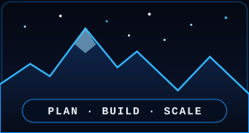

<!--
  makinity GitHub Profile README
  Cyberpunk Blue Edition (MakiSync Brand Guidelines)
  Palette: #1683DF (Primary) · #93CCE9 (Cyan Accent) · #0a0f1e (Navy Canvas)
-->

 

---

 

<!-- ==================== FEATURED PROJECTS ==================== -->

## 🚀 Featured Engineering Projects

<table>
<tr>
<td width="50%" valign="top">

### 🎮 KyroPad
> **Ultimate Wireless Precision Trackpad, Multi-Monitor Remote Screen & Macro Deck** for Windows 11 — your smartphone becomes a full PC controller over local Wi-Fi.

 

**Stack:**  
`Python` · `React Native` · `Expo` · `WebSockets` · `Win32 API`

- ⚡ Sub-millisecond touchpad gesture response
- 🖥️ Ultra-low latency remote screen streaming
- 🎛️ Customizable macro pads & quick-action triggers

 

</td>
<td width="50%" valign="top">

### 🏠 BoardEase
> Full-stack **Boarding House Management System** designed to streamline room assignments, tenant onboarding, automated billing, and rent payments.

 

**Stack:**  
`WPF (C#)` · `React Native (Expo)` · `Express.js` · `MySQL`

- 📱 Synchronized desktop & mobile ecosystem
- 💳 Real-time payment verification & rent tracking
- 📊 Automated tenant billing & revenue analytics

 

</td>
</tr>

<tr>
<td width="50%" valign="top">

### 🤖 Smart PMS
> **Smart Performance Management System** integrating machine learning models with modern web interfaces for automated institutional evaluation.

 

**Stack:**  
`Machine Learning` · `Python` · `Laravel` · `MySQL`

- 📈 Predictive performance analytics via ML models
- 🎯 Data-driven reporting & administrative dashboards
- 🔒 Role-based access control (RBAC) & audit logging

 

</td>
<td width="50%" valign="top">

### ☕ Maki Coffee Co. — Shopify Theme & AI
> Custom production-grade **Shopify e-commerce storefront** built from scratch with custom Liquid schema, AJAX cart, and an integrated AI shopping assistant.

 

**Stack:**  
`Shopify Liquid` · `JavaScript` · `Groq API` · `Tailwind CSS`

- 🛒 AJAX add-to-cart with reactive cart drawer
- 🤖 Floating AI customer assistant powered by Groq API
- 🎞️ Scroll-driven interactive micro-animations

 

</td>
</tr>
</table>

 

---

 

<!-- ==================== GITHUB STATS & STREAK ==================== -->

## 📊 Live GitHub Telemetry

<table>
<tr>
<td width="50%" align="center">
  
</td>
<td width="50%" align="center">
  
</td>
</tr>
<tr>
<td width="50%" align="center">
  
</td>
<td width="50%" align="center">
  
</td>
</tr>
</table>

 

---

 

<!-- ==================== CONTRIBUTION SNAKE ==================== -->

## 🐍 Contribution Graph

  

  🔄 <i>Updated automatically via GitHub Actions CI/CD</i>

 

---

 

<!-- ==================== CERTIFICATIONS & ACHIEVEMENTS ==================== -->

## 🏅 Certifications & International Programs

<table>
<tr>
<td width="33%" valign="top" align="center">

**🎓 COIL 2025**  
Tourism Web Application  
DDSC × EVSU · Philippines  
 

</td>
<td width="33%" valign="top" align="center">

**🎓 COIL 2026**  
SociaLite Social Media App  
DDSC × National Meanchey Univ. · Cambodia  
 

</td>
<td width="33%" valign="top" align="center">

**📜 The VA Bar**  
Intermediate Training  
SMM · Lead Gen · Graphic Design  
 

</td>
</tr>
</table>

  🎯 <b>Targeting Next:</b> AWS Certified Cloud Practitioner · GitHub Foundations

 

---

 

<!-- ==================== THE CAT ==================== -->

 

🐾 <b>Vibe coding mode:</b> enabled · fueled by coffee, clean architecture, and continuous learning

 

---

 

⚡ <b>makinity</b> · Built with precision · Powered by passion · Driven by purpose

