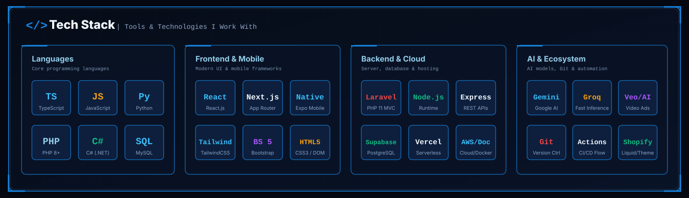

<p align="center">
  <a href="https://github.com/makinity">
    
  </a>
</p>

<p align="center">
  
</p>

<p align="center">
  <a href="https://github.com/makinity">
    
  </a>
  
  
  
</p>

<br/>

---

<br/>

## About Me

<table>
<tr>
<td width="130" align="center" style="background:#091428; border:1px solid #1683DF44; border-radius:12px; padding:16px;">
  
  <br/><br/>
  <sub>🐾 <b style="color:#93CCE9;">cat_vibe.sh</b><br/><span style="color:#22C55E;">running...</span></sub>
</td>
<td style="background:#091428; border:1px solid #1683DF44; border-radius:12px; padding:20px;">

I'm a fourth-year **BSIT student** and **full-stack developer** from the Philippines, passionate about building software that solves real-world problems.

I specialize in **Laravel**, **React.js**, **Next.js**, and **React Native**, with growing expertise in **AI integration**, **system architecture**, and **cloud technologies**. I approach every project with a planning-first mindset — understanding the problem before writing a single line of code.

When I'm not coding, I'm probably learning something new, automating my workflows, or helping businesses grow through **Social Media Management** and **Virtual Assistance**.

**What drives me:** Building technology that makes a difference. Every project is an opportunity to learn, improve, and create something meaningful.

</td>
</tr>
</table>

<br/>

---

<br/>

## 💡 Developer Philosophy

> *"Software development begins with planning, not coding. Every great system starts with understanding the problem, designing the architecture, and building for maintainability."*

<br/>

<table>
<tr>
<td width="33%" align="center" style="background:#091428; border:1px solid #1683DF55; border-radius:10px; padding:18px;">

**🎯 Plan First**
<br/>
<sub style="color:#93CCE9;">Understand → Research → Design → Build</sub>

</td>
<td width="33%" align="center" style="background:#091428; border:1px solid #1683DF55; border-radius:10px; padding:18px;">

**🏗️ Build Right**
<br/>
<sub style="color:#93CCE9;">Clean architecture, separation of concerns</sub>

</td>
<td width="33%" align="center" style="background:#091428; border:1px solid #1683DF55; border-radius:10px; padding:18px;">

**📈 Scale Fast**
<br/>
<sub style="color:#93CCE9;">Code for today, architect for tomorrow</sub>

</td>
</tr>
</table>

<br/>

---

<br/>

## 🛠️ Tech Stack

<p align="center">
  
</p>

<br/>

---

<br/>

## 🚀 Featured Projects

<br/>

<table>
<tr>
<td width="50%" valign="top" style="background:#091428; border:1px solid #1683DF44; border-radius:12px; padding:22px;">

### 🎮 KyroPad

> The **Ultimate Wireless Precision Trackpad, Multi-Monitor Remote Screen & Macro Deck** for Windows 11 — your smartphone becomes a full PC controller over local Wi-Fi.

<br/>

**Stack:**
<br/>


<br/>

**Highlights:**
- 🖱️ Hardware-grade trackpad with Windows Precision gesture support
- 🖥️ Live multi-monitor screen streaming at 20–25+ FPS
- 🎛️ Windows 11 macro deck — snap, volume, hotkeys & shortcuts
- 📡 100% local Wi-Fi WebSocket — zero cloud, sub-10ms latency
- 📱 Cross-platform mobile client (iOS & Android via Expo)
- ⌨️ Remote keyboard with Unicode text broadcast

<br/>

<a href="https://github.com/makinity/win-deck-remote">
  
</a>

</td>
<td width="50%" valign="top" style="background:#091428; border:1px solid #1683DF44; border-radius:12px; padding:22px;">

### 🎬 Caption Remover

> A Python tool that **removes burned-in subtitles and captions** from videos using AI inpainting (LaMa) — no OCR, no external API, fully local.

<br/>

**Stack:**
<br/>


<br/>

**Highlights:**
- 🤖 AI inpainting with LaMa — reconstructs background under captions
- 🖱️ Interactive ROI selector — drag to pick subtitle region visually
- 🎨 Dual color mode — handles white & black burned-in text
- 🔊 Original audio preserved automatically via FFmpeg
- ⚡ GPU auto-detect — CUDA → Apple Silicon MPS → CPU fallback
- 🌐 Web UI via Gradio + Docker-ready for deployment

<br/>

<a href="https://github.com/makinity/caption-remover">
  
</a>

</td>
</tr>
<tr>
<td width="50%" valign="top" style="background:#091428; border:1px solid #1683DF44; border-radius:12px; padding:22px;">

### 🏠 BoardEase

> A full-stack boarding house management system that handles the complete rental lifecycle: **search → reserve → rent → bill → pay**.

<br/>

**Stack:**
<br/>


<br/>

**Highlights:**
- 🖥️ WPF Desktop App (.NET 8) + 📱 React Native Mobile App
- 🎭 Role-based access (Admin, Owner, Occupant)
- 💳 Stripe & PayMongo payment integration
- 🔔 Real-time notifications via SignalR
- 🤖 Built-in AI assistant (Gemini)
- 📊 Reports & analytics

<br/>

<a href="https://github.com/makinity/BoardEase-APP">
  
</a>
<a href="https://github.com/makinity/BoardEase-Mobile">
  
</a>

</td>
<td width="50%" valign="top" style="background:#091428; border:1px solid #1683DF44; border-radius:12px; padding:22px;">

### 📊 Smart PMS

> A Smart Performance Management System integrating **machine learning** with modern web technologies for data-driven performance evaluation.

<br/>

**Stack:**
<br/>


<br/>

**Highlights:**
- 🧠 Random Forest ML model for performance prediction
- 📈 Data visualization & analytics dashboard
- 🏗️ Laravel backend with clean architecture
- 🎯 Role-based dashboards
- ⭐ Employee evaluation system
- 📋 Department management

<br/>

<a href="https://smart-pms.onrender.com/">
  
</a>
<a href="https://github.com/makinity/Smart-PMS">
  
</a>

</td>
</tr>
<tr>
<td width="50%" valign="top" style="background:#091428; border:1px solid #1683DF44; border-radius:12px; padding:22px;">

### 🎯 JobHunter AI

> An AI-powered personal automation system that monitors Facebook groups for **SMM/VA freelance gigs** and sends instant notifications via Telegram.

<br/>

**Stack:**
<br/>


<br/>

**Highlights:**
- 🤖 AI-powered job matching with Groq (LLaMA 3.1)
- 🔍 Puppeteer-based Facebook scraper
- 📱 Telegram bot notifications
- ⏰ Scheduled monitoring with GitHub Actions
- 📊 Match scoring & skill profiling
- 🔄 Auto cookie expiry reminders

<br/>

<a href="https://github.com/makinity/jobhunter-ai">
  
</a>

</td>
<td width="50%" valign="top" style="background:#091428; border:1px solid #1683DF44; border-radius:12px; padding:22px;">

### 🌐 MakiSync

> My personal brand portfolio website — a modern, minimal landing page showcasing services, projects, and professional capabilities.

<br/>

**Stack:**
<br/>


<br/>

**Highlights:**
- 🎨 Consistent MakiSync branding (#1683DF, #93CCE9)
- 📱 Fully responsive design
- ⚡ Deployed on Vercel
- 🏗️ Service showcase (SMM, VA, Web Dev)
- 📂 Project portfolio integration
- 📈 SEO-optimized

<br/>

<a href="https://maki-sync.vercel.app">
  
</a>
<a href="https://github.com/makinity/MakiSync">
  
</a>

</td>
</tr>
<tr>
<td width="50%" valign="top" style="background:#091428; border:1px solid #1683DF44; border-radius:12px; padding:22px;">

### 🍗 Chicken Express

> A web-based chicken food ordering system with **PayMongo payment integration**, featuring a customer storefront and a full admin panel.

<br/>

**Stack:**
<br/>


<br/>

**Highlights:**
- 🛒 Customer storefront — browse, cart, checkout & order tracking
- 🔐 Spring Security with role-based access (Customer / Admin)
- 💳 PayMongo hosted checkout (GCash, Maya, card)
- 🔔 Webhook-driven order status updates
- 📊 Admin dashboard with Excel & PDF reports
- 📦 Full product & order management system

<br/>

<a href="https://github.com/makinity/ChickenExpress">
  
</a>

</td>
<td width="50%" valign="top" style="background:#091428; border:1px solid #1683DF44; border-radius:12px; padding:22px;">

### ☕ Maki Coffee Co.

> A full **Shopify theme built from scratch** for a fictional specialty coffee brand — production-ready, fully branded, and portfolio-grade.

<br/>

**Stack:**
<br/>


<br/>

**Highlights:**
- 🎨 Full brand system — CSS tokens, Playfair Display, warm coffee palette
- 🧩 Custom sections with Shopify schema & block repeaters
- 🛒 Product page with gallery, variant picker & quantity stepper
- ⚡ AJAX add-to-cart with live cart count feedback
- 🤖 Floating AI chatbot widget wired to Groq API proxy
- 🎞️ Scroll-triggered animations via IntersectionObserver

<br/>

<a href="https://github.com/makinity/Shopify-Coffe-Store">
  
</a>
<a href="https://maki-practice-store.myshopify.com">
  
</a>

</td>
</tr>
</table>

<br/>

---

<br/>

## 📊 GitHub Stats

<br/>

<table>
<tr>
<td width="50%" align="center" style="background:#060b17; border:1px solid #1683DF44; border-radius:10px;">


</td>
<td width="50%" align="center" style="background:#060b17; border:1px solid #1683DF44; border-radius:10px;">


</td>
</tr>
</table>

<br/>

<table>
<tr>
<td width="50%" align="center" style="background:#060b17; border:1px solid #1683DF44; border-radius:10px;">


</td>
<td width="50%" align="center" style="background:#060b17; border:1px solid #1683DF44; border-radius:10px;">

<a href="https://github.com/ashutosh00710/github-readme-activity-graph">
  
</a>

</td>
</tr>
</table>

<br/>

---

<br/>

## 🐍 Contribution Snake

<br/>

<p align="center">
  
</p>

> *🔄 Updated automatically every 12 hours via GitHub Actions*

<br/>

---

<br/>

## 🏆 Achievements

<br/>

<p align="center">
  
  
  
  
  
</p>

<p align="center">
  
  
  
  
  
  
</p>

<br/>

---

<br/>

## 🏅 Certifications

<br/>

<table>
<tr>
<td width="33%" valign="top" align="center" style="background:#091428; border:1px solid #1683DF44; border-radius:10px; padding:18px;">

**🎓 COIL 2025**
<br/>
Tourism Web Application
<br/>
<sub>DDSC × EVSU · Philippines</sub>
<br/><br/>


</td>
<td width="33%" valign="top" align="center" style="background:#091428; border:1px solid #1683DF44; border-radius:10px; padding:18px;">

**🎓 COIL 2026**
<br/>
SociaLite Social Media App
<br/>
<sub>DDSC × National Meanchey University · Cambodia</sub>
<br/><br/>


</td>
<td width="33%" valign="top" align="center" style="background:#091428; border:1px solid #1683DF44; border-radius:10px; padding:18px;">

**📜 VA Bar — Intermediate Training**
<br/>
SMM · Lead Generation · Graphic Design
<br/>
<sub>Email Marketing · Administrative</sub>
<br/><br/>


</td>
</tr>
</table>

<br/>

<p align="center">
  <sub>🎯 <b>Working toward:</b> Google Digital Marketing · AWS Cloud Practitioner · GitHub Foundations</sub>
</p>

<br/>

---

<br/>

## 🧠 What I'm Currently Working On

<br/>

<table>
<tr>
<td width="33%" align="center" style="background:#091428; border:1px solid #1683DF44; border-radius:10px; padding:16px;">

**🎓 Academics**
<br/>
Completing BSIT degree
<br/>
<sub>Expected graduation: 2026</sub>

</td>
<td width="33%" align="center" style="background:#091428; border:1px solid #1683DF44; border-radius:10px; padding:16px;">

**🏗️ BoardEase**
<br/>
Full-stack boarding house system
<br/>
<sub>Desktop + Mobile + API</sub>

</td>
<td width="33%" align="center" style="background:#091428; border:1px solid #1683DF44; border-radius:10px; padding:16px;">

**🤖 AI Integration**
<br/>
Learning ML & AI patterns
<br/>
<sub>Gemini API, Groq, automation</sub>

</td>
</tr>
</table>

<table>
<tr>
<td width="33%" align="center" style="background:#091428; border:1px solid #1683DF44; border-radius:10px; padding:16px;">

**☁️ Cloud & DevOps**
<br/>
AWS Cloud Practitioner
<br/>
<sub>Building deployment skills</sub>

</td>
<td width="33%" align="center" style="background:#091428; border:1px solid #1683DF44; border-radius:10px; padding:16px;">

**💼 Freelancing**
<br/>
SMM & VA services
<br/>
<sub>Building portfolio & clients</sub>

</td>
<td width="33%" align="center" style="background:#091428; border:1px solid #1683DF44; border-radius:10px; padding:16px;">

**🚀 MakiSync**
<br/>
Expanding personal brand
<br/>
<sub>Services, portfolio, products</sub>

</td>
</tr>
</table>

<br/>

---

<br/>

## 🎯 Goals & Ambitions

<br/>

```
🎯 SHORT-TERM (3-6 months)
├── ✅ MakiSync Portfolio Website — Complete
├── ✅ BoardEase — Full-stack system — Complete
├── ✅ Smart PMS — ML-integrated system — Live 🚀
├── 🔨 Secure remote position (Software Engineer / VA)
├── 🔨 Build 3-5 paying freelance clients
├── 🔨 AWS Cloud Practitioner certification
└── 🔨 Earn stable income ₱20K-₱40K/month

🎯 MID-TERM (6-12 months)
├── 🎓 Graduate with BSIT degree
├── 📊 Build professional SMM portfolio
├── 💰 Achieve consistent ₱40K+/month
└── 🏗️ Establish MakiSync as umbrella brand

🎯 LONG-TERM (1-3 years)
├── 🌍 Financial independence through remote work
├── 🚀 Launch own SaaS product
├── 🏢 Build technology business
└── ✈️ Travel internationally
```

<br/>

---

<br/>

## 🤝 Let's Connect

<br/>

<p align="center">
  <a href="https://maki-sync.vercel.app">
    
  </a>
  <a href="https://github.com/makinity">
    
  </a>
  <a href="https://www.linkedin.com/in/mark-vencent-juntilla-366328358">
    
  </a>
  <a href="mailto:markjuntillava@gmail.com">
    
  </a>
  <a href="https://t.me/MakiSyncBot">
    
  </a>
</p>

<br/>

<p align="center">
  <sub>💬 <b>Available for:</b> Remote Software Engineering roles · Freelance Web Development · SMM & Virtual Assistance</sub>
</p>

<br/>

---

<br/>

<p align="center">
  <a href="https://github.com/makinity">
    
  </a>
</p>

<p align="center">
  <sub>⚡ Built with precision · Powered by passion · Driven by purpose</sub>
</p>
