<p align="center">
  <a href="https://github.com/makinity">
    
  </a>
</p>

<p align="center">
  
</p>

<p align="center">
  <a href="https://github.com/makinity">
    
  </a>
  
  
  
</p>

<br/>

---

<br/>

## About Me

<p align="center">
  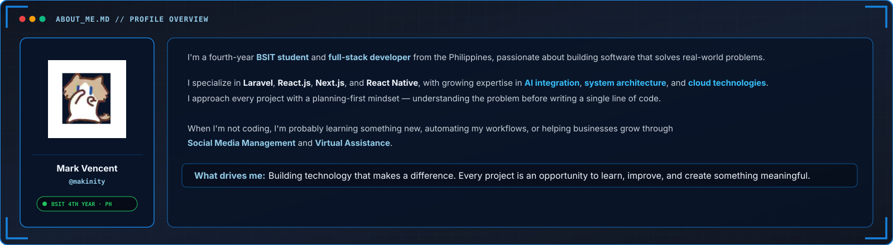
</p>

<br/>

---

<br/>

## 💡 Developer Philosophy

<p align="center">
  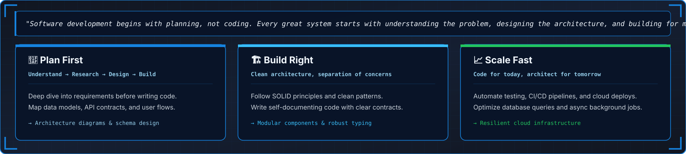
</p>

<br/>

---

<br/>

## 🛠️ Tech Stack

<p align="center">
  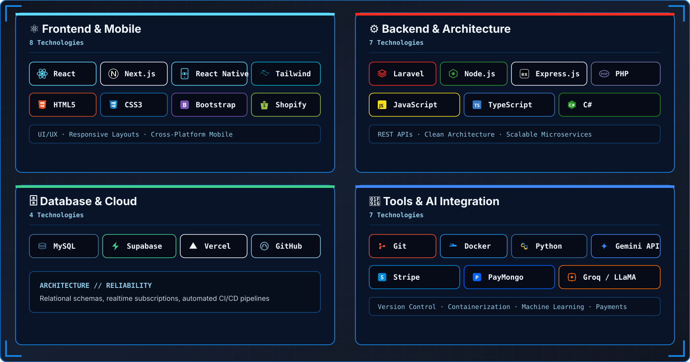
</p>

<br/>

---

<br/>

## 🚀 Featured Projects

<p align="center">
  <a href="https://github.com/makinity/KyroPad">
    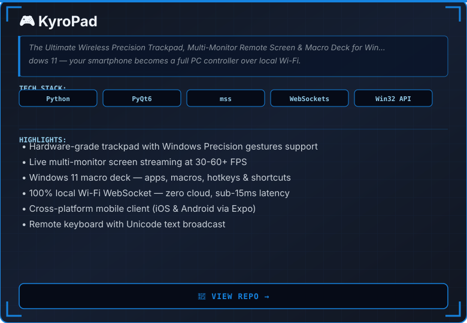
  </a>
  <a href="https://github.com/makinity/Caption-Remover">
    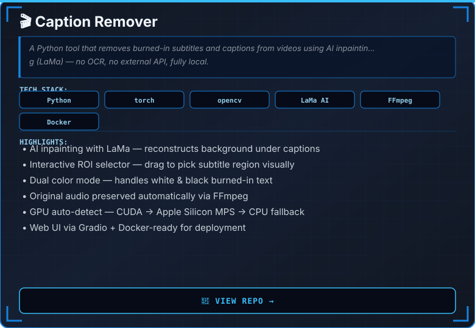
  </a>
</p>

<p align="center">
  <a href="https://github.com/makinity/BoardEase-Mobile">
    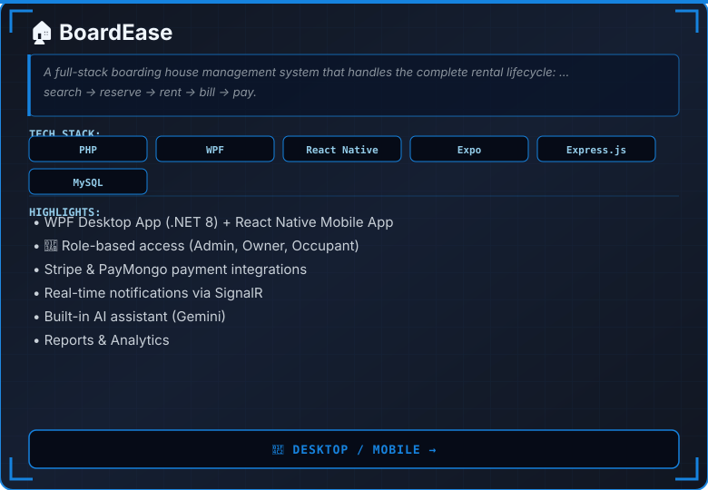
  </a>
  <a href="https://github.com/makinity/Smart-PMS">
    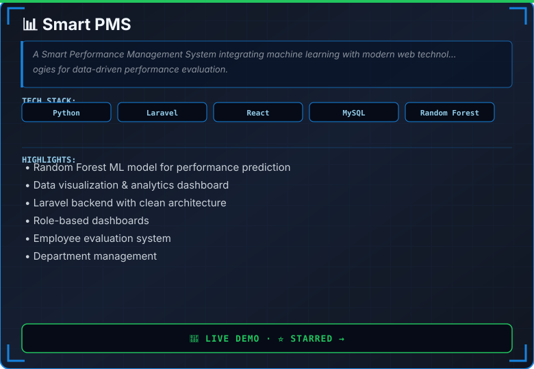
  </a>
</p>

<p align="center">
  <a href="https://github.com/makinity/jobhunter-ai">
    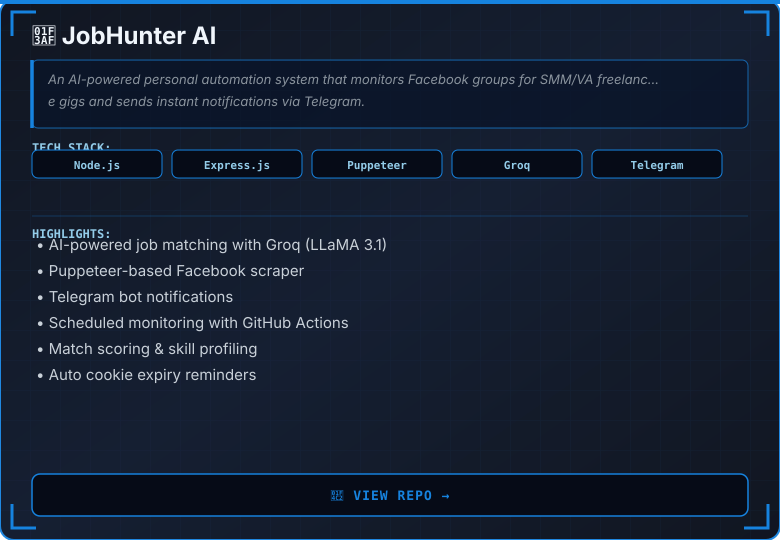
  </a>
  <a href="https://maki-sync.vercel.app">
    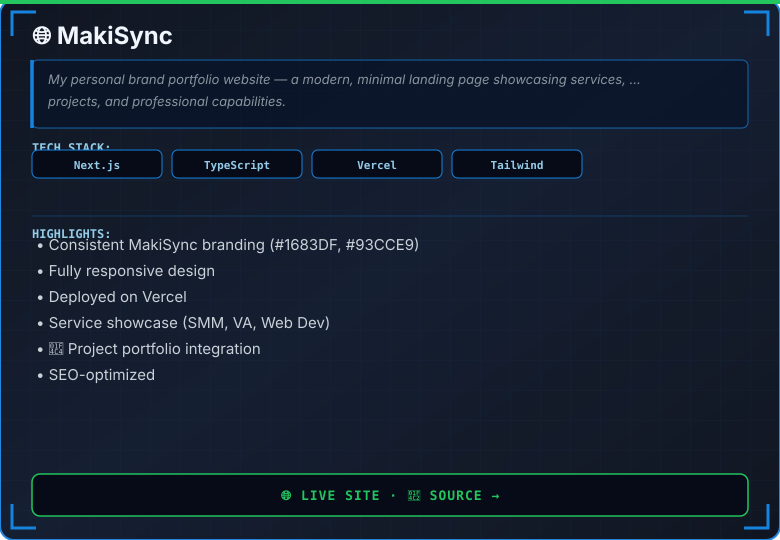
  </a>
</p>

<p align="center">
  <a href="https://github.com/makinity/ChickenExpress">
    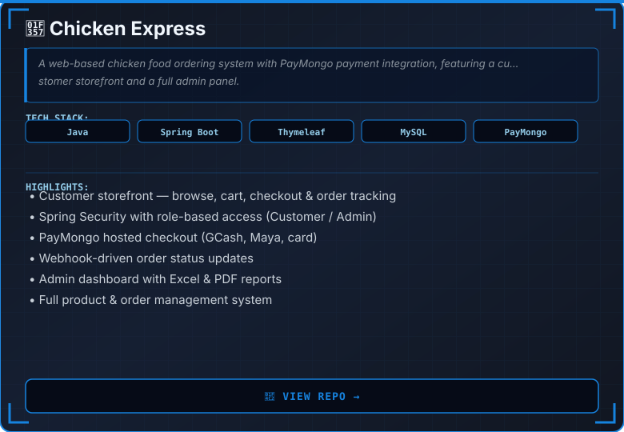
  </a>
  <a href="https://github.com/makinity/Shopify-Coffe-Store">
    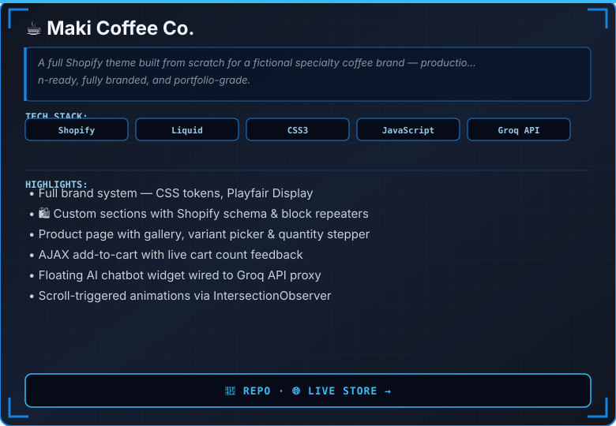
  </a>
</p>

<br/>

---

<br/>

## 📊 GitHub Stats

<br/>

<p align="center">
  
  
</p>

<p align="center">
  
  
</p>

<br/>

---

<br/>

## 🐍 Contribution Snake

<br/>

<p align="center">
  
</p>

<p align="center">
  <sub>🔄 Updated automatically every 12 hours via GitHub Actions</sub>
</p>

<br/>

---

<br/>

## 🏆 Achievements

<br/>

<p align="center">
  
  
  
  
  
</p>

<p align="center">
  
  
  
  
  
  
</p>

<br/>

---

<br/>

## 🏅 Certifications

<p align="center">
  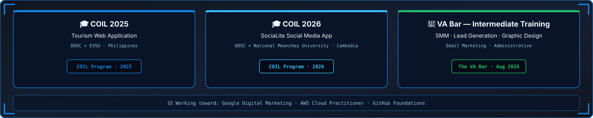
</p>

<br/>

---

<br/>

## 🧠 What I'm Currently Working On

<p align="center">
  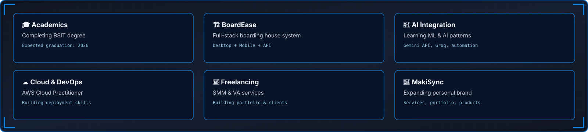
</p>

<br/>

---

<br/>

## 🎯 Goals & Ambitions

<br/>

```
🎯 SHORT-TERM (3-6 months)
├── ✅ MakiSync Portfolio Website — Complete
├── ✅ BoardEase — Full-stack system — Complete
├── ✅ Smart PMS — ML-integrated system — Live 🚀
├── 🔨 Secure remote position (Software Engineer / VA)
├── 🔨 Build 3-5 paying freelance clients
├── 🔨 AWS Cloud Practitioner certification
└── 🔨 Earn stable income ₱20K-₱40K/month

🎯 MID-TERM (6-12 months)
├── 🎓 Graduate with BSIT degree
├── 📊 Build professional SMM portfolio
├── 💰 Achieve consistent ₱40K+/month
└── 🏗️ Establish MakiSync as umbrella brand

🎯 LONG-TERM (1-3 years)
├── 🌍 Financial independence through remote work
├── 🚀 Launch own SaaS product
├── 🏢 Build technology business
└── ✈️ Travel internationally
```

<br/>

---

<br/>

## 🤝 Let's Connect

<br/>

<p align="center">
  <a href="https://maki-sync.vercel.app">
    
  </a>
  <a href="https://github.com/makinity">
    
  </a>
  <a href="https://www.linkedin.com/in/mark-vencent-juntilla-366328358">
    
  </a>
  <a href="mailto:markjuntillava@gmail.com">
    
  </a>
  <a href="https://t.me/MakiSyncBot">
    
  </a>
</p>

<br/>

<p align="center">
  <sub>💬 <b>Available for:</b> Remote Software Engineering roles · Freelance Web Development · SMM &amp; Virtual Assistance</sub>
</p>

<br/>

---

<br/>

<p align="center">
  <a href="https://github.com/makinity">
    
  </a>
</p>

<p align="center">
  <sub>⚡ Built with precision · Powered by passion · Driven by purpose</sub>
</p>
